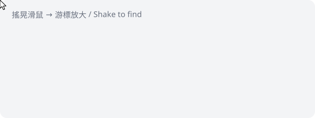

# ShakeCursor

<p align="center"></p>

**Shake your mouse to find the cursor — on Windows.**
macOS 的「搖晃以尋找游標」，搬到 Windows。

Lost your pointer on a 4K / multi-monitor setup? Wiggle the mouse back and forth and the cursor swells to 9× its size, then shrinks back the moment you stop.

- 🪶 **Tiny** — single ~12 KB `.exe`, one ~260-line C# file, zero dependencies
- 🧩 **No install** — uses the .NET Framework already built into Windows 10/11
- 🖱️ **Non-intrusive** — click-through overlay, never steals focus, lives in the system tray
- 🖥️ **DPI-aware** — looks crisp on high-DPI displays
- 🚀 **Optional autostart** — toggle from the tray menu (per-user, no admin needed)

## 下載 / Download

Grab `ShakeCursor.exe` from [Releases](../../releases/latest) and double-click it. A cursor icon appears in the tray.

> Windows SmartScreen may warn because the exe is unsigned. Click **More info → Run anyway**, or build it yourself from source (below).

## 使用 / Usage

| 動作 | 效果 |
|---|---|
| 快速左右（或上下）晃動滑鼠 | 游標放大 |
| 停下來約 0.5 秒 | 游標縮回 |
| 系統匣圖示右鍵 → 開機自動啟動 | 寫入 `HKCU\...\Run`，再點一次取消 |
| 系統匣圖示右鍵 → 結束 | 關閉程式 |

## 自己編譯 / Build from source

No Visual Studio needed — Windows ships with the C# compiler:

```bat
build.bat
```

That runs:

```bat
%WINDIR%\Microsoft.NET\Framework64\v4.0.30319\csc.exe /target:winexe /optimize+ /out:ShakeCursor.exe /r:System.Windows.Forms.dll /r:System.Drawing.dll ShakeCursor.cs
```

## 調整 / Tuning

Edit the constants at the top of `ShakeCursor.cs` and rebuild:

| 常數 | 預設 | 意義 |
|---|---|---|
| `BigScale` | `9` | 放大倍率 |
| `ReversalsNeeded` | `4` | 時間窗內要換幾次方向才觸發 |
| `WindowMs` | `800` | 偵測時間窗（ms） |
| `MinSegmentPx` | `25` | 每段來回至少移動幾 px |
| `StillMs` | `450` | 停下多久後縮回（ms） |

## 原理 / How it works

A 15 ms timer polls `GetCursorPos`. Each axis tracks its direction; a direction flip after a long-enough segment counts as a *reversal*. Four reversals inside 800 ms = shake. The big arrow is drawn with GDI+ onto a transparent, click-through, topmost layered window (`UpdateLayeredWindow`) that follows the pointer, and eases in/out.

The real system cursor is untouched — nothing is changed in your cursor settings.

## License

MIT
